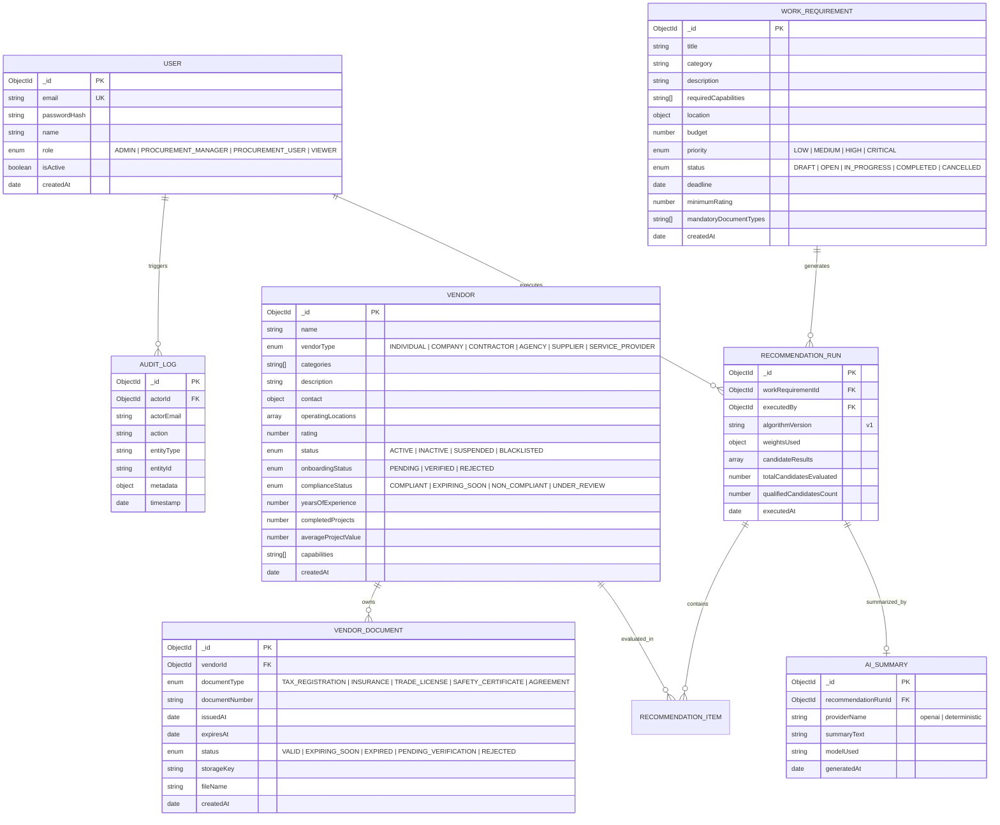
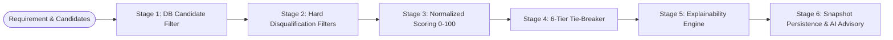

# FieldNerve — Enterprise Vendor & Work Management Platform

FieldNerve is an enterprise-grade **Vendor & Work Requirement Management Platform** engineered with the MERN stack (**MongoDB, Express.js, React, Node.js**) in full **TypeScript**. 

It enables organizations to register and audit vendors, govern document compliance lifecycles, publish work requirements, and intelligently recommend the most suitable vendors through a **deterministic, explainable recommendation engine** complemented by an **AI executive advisory layer** with offline deterministic fallback.

---

## Table of Contents
1. [Project Architecture](#1-project-architecture)
2. [Database Design & Modeling](#2-database-design--modeling)
3. [API Design & Security](#3-api-design--security)
4. [Recommendation Engine Logic](#4-recommendation-engine-logic)
5. [AI Intelligence Layer & Guardrails](#5-ai-intelligence-layer--guardrails)
6. [System Assumptions](#6-system-assumptions)
7. [Architectural Trade-offs](#7-architectural-trade-offs)
8. [Local Setup & Verification Guide](#8-local-setup--verification-guide)
9. [Seed Scenarios & RBAC Credentials](#9-seed-scenarios--rbac-credentials)

---

## 1. Project Architecture

### High-Level System Architecture

FieldNerve is architected as a **Modular Monolith** on the backend paired with a **Single-Page Application (SPA)** on the frontend. The modular monolith combines the operational simplicity of a single deployable artifact with the domain isolation, loose coupling, and maintainability of microservices.

```mermaid
flowchart TD
    subgraph Client [Client Tier — React 18 + Vite + TypeScript]
        UI[Enterprise Web Console]
        AuthCtx[Auth Context & JWT Session Storage]
        Views[Dashboard | Vendors | Requirements | Recommendations | Audit]
    end

    subgraph Gateway [API Gateway & Middleware Pipeline]
        CORS[CORS Policy]
        Helmet[Helmet Security Headers]
        RateLimit[Rate Limiting (100 req / 15 min)]
        ReqID[Correlation ID Middleware (x-request-id)]
        JWTAuth[JWT Authenticator & RBAC Guard]
        ZodVal[Zod Schema Request Validator]
    end

    subgraph Backend [Backend Modular Monolith — Express + TypeScript]
        AuthMod[Auth Module\nBcrypt + JWT]
        VendorMod[Vendor Management Module\nCRUD + Location Geo-Indexing]
        DocMod[Vendor Documents & Compliance\nState Engine + Audit Triggers]
        ReqMod[Work Requirements Module\nLifecycle Management]
        RecMod[Recommendation Engine\nPure Function Scoring + Snapshot Run]
        AIMod[AI Intelligence Layer\nProvider Factory]
        AuditMod[Audit Service\nImmutable Event Logging]
    end

    subgraph DataTier [Persistence & External Services]
        Mongo[(MongoDB Atlas / Local\nCompound & Text Indexes)]
        OpenAI[OpenAI API (gpt-4o-mini)\nAdvisory Summaries]
        FallbackEngine[Deterministic Fallback Engine\n100% Offline / Zero API Keys]
    end

    UI -->|HTTPS REST| Gateway
    Gateway --> AuthMod
    Gateway --> VendorMod
    Gateway --> DocMod
    Gateway --> ReqMod
    Gateway --> RecMod
    Gateway --> AuditMod

    RecMod -->|1. Candidate Pre-Filter Query| Mongo
    RecMod -->|2. Pure In-Memory Scoring| RecMod
    RecMod -->|3. Persist Snapshot Run| Mongo
    RecMod -->|4. Request Fact Summary| AIMod

    AIMod -->|If Key Configured| OpenAI
    AIMod -->|If Offline / Timeout / Fallback| FallbackEngine

    DocMod -->|Reactive Recalculation| VendorMod
    DocMod -->|Log Event| AuditMod
    VendorMod --> Mongo
    DocMod --> Mongo
    ReqMod --> Mongo
    AuditMod --> Mongo
```

### Layered Modular Monolith Design
The backend is structured into vertical feature slices under `backend/src/modules/`:
* **`auth/`**: User registration, password hashing (`bcryptjs`), JWT issuance, and authentication middleware.
* **`vendors/`**: Vendor registry, multi-parameter search, contact management, and geographic location querying.
* **`vendor-documents/`**: Document lifecycle state machine (`PENDING_VERIFICATION`, `VALID`, `EXPIRING_SOON`, `EXPIRED`, `REJECTED`), compliance recalculation, and batch verification.
* **`work-requirements/`**: Work requisition management, scope definition, budget ceilings, and timeline governance.
* **`recommendations/`**: Pure-function recommendation scoring pipeline, 6-tier deterministic tie-breakers, explainability generators, and run snapshot persistence.
* **`ai/`**: AI provider factory, OpenAI integration with strict schema output, and zero-dependency deterministic fallback engine.
* **`audit/`**: Append-only audit logger capturing all mutating operational actions.

---

## 2. Database Design & Modeling

FieldNerve uses **MongoDB with Mongoose schemas**, prioritizing strict schema typing, compound indexing for search efficiency, and data consistency.

### Entity Relationship Diagram (ERD)



### Document Modeling Decisions: Normalization vs. Embedding

1. **Vendor Documents (Normalized)**:
   * **Design Decision**: Kept in a separate `vendor_documents` collection rather than embedded in `vendors.documents`.
   * **Rationale**: Embedding unbounded document arrays risks reaching MongoDB's 16MB document size limit and creates document write-lock contention. A dedicated collection allows independent auditing, lifecycle updates (e.g. daily expiration cron scans), and fine-grained indexing.
2. **Materialized Compliance Status (Denormalized)**:
   * **Design Decision**: `complianceStatus` is stored on the `Vendor` document and reactively recalculated upon document mutation.
   * **Rationale**: Allows instant pre-filtering in recommendation queries (`{ complianceStatus: { $ne: 'NON_COMPLIANT' } }`) without performing an expensive multi-collection `$lookup` for thousands of vendors on every search request.
3. **Recommendation Run Snapshots (Immutable Document)**:
   * **Design Decision**: `recommendation_runs` stores a complete point-in-time snapshot of vendor scores, rankings, weights, and explanation breakdowns.
   * **Rationale**: Procurement recommendations require auditable legal reproducibility. If a vendor's rating or documents change later, the historic snapshot proves exactly why a vendor was awarded or disqualified on that date.

### Indexing Strategy
* **Vendor Compound Search**:
  * `{ status: 1, categories: 1, rating: -1 }`: Optimizes recommendation candidate queries.
  * `{ 'operatingLocations.city': 1, 'operatingLocations.state': 1 }`: Regional proximity searches.
  * `{ name: 'text', description: 'text', capabilities: 'text' }`: Multi-field keyword search across directory.
* **Document Expiry & Verification**:
  * `{ vendorId: 1, documentType: 1 }`: Quick compliance checks per vendor.
  * `{ expiresAt: 1, status: 1 }`: Fast batch scanning for expirations ($\le 30$ days).
* **Audit Trail**:
  * `{ entityType: 1, entityId: 1, timestamp: -1 }`: Instant timeline lookup for any specific record.

---

## 3. API Design & Security

All API endpoints follow RESTful conventions, returning standardized JSON response envelopes and structured errors with distributed trace headers.

### Standard Response Envelope
```json
{
  "success": true,
  "data": { ... },
  "meta": {
    "page": 1,
    "limit": 20,
    "total": 15
  }
}
```

### Standard Error Envelope (with Correlation ID)
```json
{
  "success": false,
  "error": {
    "code": "VALIDATION_ERROR",
    "message": "Validation failed",
    "details": [
      { "field": "body.email", "message": "Valid email is required" }
    ],
    "requestId": "9b1deb4d-3b7d-4bad-9bdd-2b0d7b3dcb6d"
  }
}
```

### Complete API Endpoint Catalog

| HTTP Method | Endpoint | Description | Minimum Role |
| :--- | :--- | :--- | :--- |
| **AUTH** | | | |
| `POST` | `/api/v1/auth/register` | Register new user account with role selection | Public |
| `POST` | `/api/v1/auth/login` | Authenticate user & issue signed JWT | Public |
| `GET` | `/api/v1/auth/me` | Fetch active authenticated profile | Any authenticated |
| **VENDORS** | | | |
| `GET` | `/api/v1/vendors` | Search & filter vendors (category, status, compliance, rating) | Any authenticated |
| `POST` | `/api/v1/vendors` | Register new enterprise vendor | `PROCUREMENT_MANAGER` |
| `GET` | `/api/v1/vendors/:id` | Fetch vendor 360° profile details | Any authenticated |
| `PUT` | `/api/v1/vendors/:id` | Update vendor profile and operating locations | `PROCUREMENT_MANAGER` |
| `DELETE`| `/api/v1/vendors/:id` | Delete vendor profile | `ADMIN` |
| **DOCUMENTS & COMPLIANCE** | | | |
| `GET` | `/api/v1/vendor-documents/vendor/:vendorId` | List compliance documents for a vendor | Any authenticated |
| `POST` | `/api/v1/vendor-documents` | Register new document metadata | `PROCUREMENT_MANAGER` |
| `PATCH`| `/api/v1/vendor-documents/:id/status` | Verify (`VALID`) or reject (`REJECTED`) a document | `PROCUREMENT_MANAGER` |
| `POST` | `/api/v1/vendor-documents/vendor/:id/review-compliance` | Trigger comprehensive compliance audit with findings | `PROCUREMENT_MANAGER` |
| `POST` | `/api/v1/vendor-documents/vendor/:id/verify-all` | Batch verify all pending documents | `PROCUREMENT_MANAGER` |
| **WORK REQUIREMENTS** | | | |
| `GET` | `/api/v1/work-requirements` | List enterprise requisitions with pagination | Any authenticated |
| `POST` | `/api/v1/work-requirements` | Create work requirement | `PROCUREMENT_USER` |
| `GET` | `/api/v1/work-requirements/:id` | Fetch work requirement details | Any authenticated |
| `PUT` | `/api/v1/work-requirements/:id` | Update requirement budget or parameters | `PROCUREMENT_USER` |
| **RECOMMENDATION ENGINE** | | | |
| `GET` | `/api/v1/work-requirements/:id/recommendations` | Execute recommendation pipeline & AI advisory summary | Any authenticated |
| `GET` | `/api/v1/work-requirements/:id/recommendations/history` | List historical snapshot runs | Any authenticated |
| **AUDIT & SYSTEM** | | | |
| `GET` | `/api/v1/audit-logs` | Immutable audit trail with actor details | `ADMIN` |
| `GET` | `/health` | Live system health (MongoDB, AI provider status) | Public |

### Security Measures
1. **JWT Verification**: Signed using `HS256` with expiration controls.
2. **Password Security**: Strong salt hashing with `bcryptjs` (cost factor 10).
3. **Role-Based Access Control (RBAC)**: Declarative route middleware (`authorize(UserRole.ADMIN, ...)`).
4. **Input Sanitization**: Strict `Zod` schemas validate body, query, and path params, stripping unexpected fields.
5. **Security Headers**: `Helmet` disables `x-powered-by`, sets `X-Content-Type-Options: nosniff`, and configures frameguard protections.
6. **Rate Limiting**: Configured at 100 requests per 15 minutes per IP on `/api/v1/` routes.

---

## 4. Recommendation Engine Logic

The recommendation engine is designed with **mathematical determinism and explainability** as first-class constraints. Given the exact same vendor database state and work requirement, the engine **always produces the exact same ranked output**.

### Multi-Stage Pipeline Execution



### Stage 1: Candidate Pre-Filtering (Database Layer)
To prevent N+1 query bottlenecks and excessive memory allocation, MongoDB pre-filters eligible records using compound indexes:
* `status: ACTIVE` (excludes `INACTIVE`, `SUSPENDED`, `BLACKLISTED`)
* `onboardingStatus: VERIFIED`
* `categories: requirement.category`
* `rating: { $gte: requirement.minimumRating }`

All candidate documents are fetched in a single batch query:
```typescript
VendorDocumentModel.find({ vendorId: { $in: candidateIds } }).lean();
```

### Stage 2: Hard Disqualification Filters (Pure Function)
Candidates that pass the database pre-filter are subjected to strict domain disqualification checks:
1. **Status**: Must be `ACTIVE`.
2. **Onboarding**: Must be `VERIFIED`.
3. **Category Match**: Primary category must align with the requisition.
4. **Rating Threshold**: Vendor rating $\ge \text{requirement.minimumRating}$.
5. **Geographic Coverage**: Must have operating presence in the target state or country.
6. **Mandatory Compliance**: Must possess all required documents (e.g. `INSURANCE`, `SAFETY_CERTIFICATE`) with status `VALID` and non-expired expiration dates.

Disqualified vendors are **not dropped silently**; they are categorized as `DISQUALIFIED` with explicit, auditable disqualification reasons (e.g., `"Required compliance document 'SAFETY_CERTIFICATE' is expired"`).

### Stage 3: Normalized Weighted Scoring (v1 Algorithm)
Every qualified candidate is evaluated across seven normalized dimensions ($0.0 \to 100.0$):

$$\text{Final Score} = \sum (\text{Component Score}_i \times \text{Weight}_i)$$

$$\text{Final Score} = (C \times 0.30) + (L \times 0.20) + (R \times 0.15) + (K \times 0.15) + (M \times 0.10) + (E \times 0.05) + (A \times 0.05)$$

| Component | Weight | Metric Normalization Logic |
| :--- | :---: | :--- |
| **Category Match ($C$)** | **30%** | Exact primary category match = $100$. Secondary/sub-category = $70$. |
| **Location Proximity ($L$)** | **20%** | City match = $100$. Same State/Province = $80$. Same Country = $50$. Out-of-region = $0$. |
| **Vendor Rating ($R$)** | **15%** | Normalized: $\frac{\text{Rating}}{5.0} \times 100$. (e.g. $4.8 \to 96.0$). |
| **Capabilities Overlap ($K$)** | **15%** | Jaccard-style match ratio: $\frac{|\text{VendorCapabilities} \cap \text{RequiredCapabilities}|}{|\text{RequiredCapabilities}|} \times 100$. |
| **Document Compliance ($M$)** | **10%** | $100$ if all active. Deduct $20$ points for documents marked `EXPIRING_SOON` ($\le 30$ days to expiry). |
| **Experience ($E$)** | **5%** | Composite of completed projects ($\min(50, \text{Projects}) \times 1.2$) and years experience ($\min(10, \text{Years}) \times 4.0$). |
| **Operational Availability ($A$)** | **5%** | Baseline active capacity ($95$). Adjusted by current active project load. |

### Stage 4: Deterministic 6-Tier Tie-Breaker Chain
When two candidates share identical composite scores, ties are resolved deterministically without random ordering:
1. Higher **Composite Score**
2. Higher **Star Rating** ($4.9 > 4.8$)
3. Higher **Compliance Score** ($100 > 80$)
4. More **Completed Projects** ($45 > 30$)
5. Vendor **Name** ascending (Alphabetical: *Apex* beats *Beacon*)
6. Vendor **ID** ascending (Guaranteed unique resolution)

### Stage 5: Structured Explainability Engine
Every recommendation includes a human-readable explanation payload:
```json
{
  "vendorId": "651f8a7e2b8c9d001f3e5a1b",
  "rank": 1,
  "score": 96.50,
  "eligibility": "ELIGIBLE",
  "explanation": {
    "summary": "Outstanding top-tier candidate with excellent technical, regional, and compliance alignment",
    "strengths": [
      "Exact primary category match for Electrical Engineering",
      "Local physical presence in Austin, TX",
      "Exceptional vendor rating (4.9/5.0)",
      "100% capability match covering all required skill sets",
      "All required compliance documents are verified and fully active"
    ],
    "weaknesses": [],
    "scoreBreakdown": {
      "category": 100,
      "location": 100,
      "rating": 98,
      "capability": 100,
      "compliance": 100,
      "experience": 88,
      "availability": 95
    }
  }
}
```

---

## 5. AI Intelligence Layer & Guardrails

### Core Architectural Principle
> **The AI NEVER decides rankings or calculates numerical scores.**
> All mathematical rankings, scores, and disqualifications are computed by the deterministic engine **before** the AI layer is invoked.

### Why This Guardrail Is Essential:
1. **Audit & Compliance Safety**: Procurement decisions are subject to legal scrutiny. Non-deterministic LLM ranking introduces hallucinations, bias, and non-reproducible outcomes.
2. **Cost & Latency**: Running multi-vendor comparative scoring through LLMs is slow (2–5 seconds) and expensive. The deterministic engine scores 100 vendors in $< 15\text{ms}$.
3. **Explainability**: The deterministic engine provides verifiable mathematical proofs for every decision.

### AI Provider Architecture

```mermaid
flowchart TD
    RecEngine[Deterministic Recommendation Engine] -->|Ranked Results + Explanations| AIFactory{AI Provider Factory}
    AIFactory -->|If OPENAI_API_KEY set & AI_PROVIDER=openai| OpenAIProv[OpenAIProvider (gpt-4o-mini)]
    AIFactory -->|If AI_PROVIDER=deterministic or API offline| FallbackProv[DeterministicFallbackProvider]
    
    OpenAIProv -->|Synthesize Executive Markdown| FinalSummary[Executive Advisory Summary]
    FallbackProv -->|Algorithmic Markdown Synthesis| FinalSummary
```

* **`OpenAIProvider`**: Invokes OpenAI (`gpt-4o-mini`) with temperature `0.2` and strict system instructions to act purely as an **advisory procurement synthesizer**. It transforms the structured breakdown into an executive briefing without altering ranks.
* **`DeterministicFallbackProvider`**: Runs **100% offline with zero external API keys**. It programmatically analyzes the winner's margins, capability coverage, and runner-up comparisons to generate executive-ready markdown.
* **Automatic Failover**: If OpenAI times out (6-second circuit breaker) or the network is disconnected, the engine falls back to the deterministic provider without interrupting user workflow.

---

## 6. System Assumptions

1. **Document Verification Gate**:
   * A vendor with **0 compliance documents** on file defaults to `UNDER_REVIEW`.
   * Any expired or rejected required document results in immediate `NON_COMPLIANT` status and disqualification from work recommendations.
2. **Compliance Renewal Window**:
   * Documents expiring within $\le 30$ days transition to `EXPIRING_SOON` and receive a score deduction, alerting managers to request renewals.
3. **Geographic Proximity**:
   * Location matching is evaluated hierarchically (`City` $\to$ `State` $\to$ `Country`). Distance radius calculation can be extended via geospatial coordinates already defined in the schema.
4. **Single-Currency Base**:
   * Project values and budgets are denominated in USD.
5. **Stateless Authentication**:
   * JWT tokens are stateless with an expiration window (7 days). Session revocation is handled client-side via token eviction.

---

## 7. Architectural Trade-offs

| Architectural Decision | Alternative Considered | Selected Approach | Trade-off Rationale |
| :--- | :--- | :--- | :--- |
| **Backend Architecture** | Microservices Architecture | **Modular Monolith** | Microservices introduce distributed transaction complexity, network overhead, and complex deployment pipelines. A modular monolith provides clean domain separation with zero distributed system friction. |
| **Recommendation Engine** | MongoDB Aggregation Pipeline | **Pure In-Memory Functions** | Aggregation pipelines are difficult to unit-test, debug, and version-control. In-memory pure functions are testable in milliseconds with Vitest, portable, and mathematically deterministic. |
| **Document Storage** | Direct S3 Cloud Uploads | **Abstracted Storage Keys** | Avoids requiring AWS credentials or local MinIO containers during local evaluation. Document records store metadata and storage keys, fully ready for S3 presigned URL integration. |
| **Vendor Document Schema**| Embedded array in `Vendor` | **Normalized Collection** | Embedded arrays risk unbounded document growth and lack atomic verification triggers. A normalized collection allows independent indexing and audit triggers. |
| **AI Role in System** | LLM-based Scoring & Ranking | **Deterministic Scoring + Advisory AI** | LLM scoring introduces hallucination risk, stochastic inconsistency, and procurement audit vulnerability. Pure-function scoring ensures legal reproducibility. |
| **Authentication Session** | Redis-backed Session Store | **Stateless JWTs** | Stateless JWTs eliminate the dependency on a Redis cache instance, simplifying the deployment stack while providing verified RBAC. |

---

## 8. Local Setup & Verification Guide

### Prerequisites
* **Node.js** (v20+ recommended)
* **MongoDB** (Local instance on `mongodb://localhost:27017` or MongoDB Atlas URI)
* **npm** (v9+)

> **Port Notice**: On macOS, Apple AirPlay Receiver reserves port 5000. FieldNerve backend is configured to **Port 5001** to prevent conflicts.

### Step 1: Configure Environment Variables
```bash
# Navigate to backend
cd backend
cp .env.example .env
```
Ensure your `backend/.env` file has:
```env
PORT=5001
MONGODB_URI=mongodb://localhost:27017/fieldnerve
JWT_SECRET=super-secret-jwt-key-for-development-mode-12345
AI_PROVIDER=deterministic
```
*(By default, `AI_PROVIDER=deterministic` runs fully offline with zero API keys required!)*

### Step 2: Install Dependencies & Run Automated Tests
```bash
# In backend/
npm install
npm test
```
*Executes all 19 unit & integration tests covering pure function scoring, 6-level tie-breakers, hard filters, and API health.*

### Step 3: Seed Database
```bash
# In backend/
npm run seed
```
*Seeds 4 enterprise user accounts, 15 realistic vendor profiles, and 5 work requirements.*

### Step 4: Start Backend Dev Server
```bash
# In backend/
npm run dev
```
*Backend initializes on `http://localhost:5001`. Health endpoint: `http://localhost:5001/health`.*

### Step 5: Start Frontend Application
In a separate terminal:
```bash
cd frontend
npm install
npm run dev
```
*Frontend launches on `http://localhost:5173` with Vite hot-reloading and proxy configured to port 5001.*

---

## 9. Seed Scenarios & RBAC Credentials

### Default User Credentials
Password for all accounts: **`Password123!`**

| Name | Email | Role | Platform Permissions |
| :--- | :--- | :---: | :--- |
| **Eleanor Vance** | `admin@fieldnerve.com` | `ADMIN` | Full control, vendor deletions, audit trails, system configuration |
| **Marcus Brody** | `manager@fieldnerve.com` | `PROCUREMENT_MANAGER` | Vendor onboarding, document approval, compliance audits |
| **Sophia Chen** | `buyer@fieldnerve.com` | `PROCUREMENT_USER` | Create work requirements, execute AI recommendations |
| **David Kim** | `viewer@fieldnerve.com` | `VIEWER` | Read-only access across directory, requisitions, and compliance |

### Pre-configured Procurement Test Scenarios
1. **Clear Winner**: *Apex Power Grid Systems* (Austin, TX) achieves Rank #1 for the Austin Substation Upgrade due to local presence, 4.9 rating, and 100% compliance.
2. **Disqualified by Expired Safety Cert**: *Voltaic Energy Contractors* has a high rating (4.7) and Austin location, but is **disqualified** with reason: `"Required compliance document 'SAFETY_CERTIFICATE' is expired"`.
3. **Rating vs. Proximity Trade-off**: *Lumina Industrial Electric* holds a 4.95 rating and enterprise certifications, but ranks lower because its location is Denver, CO (state mismatch).
4. **Deterministic Tie-Breaking**: *Austin ElectroCorp* and *Beacon Power Labs* have identical ratings (4.6) and capabilities; *Austin ElectroCorp* wins the tie-breaker based on having more completed projects (35 vs 30).
5. **Blacklisted & Low Rating Disqualifications**: *Rogue Electrical* (Blacklisted) and *Budget Wire Specialists* (rating 3.2 < required 4.0) are automatically disqualified.
